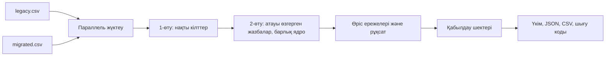

<div align="center">

# driftcheck

**Деректерді көшіруді жазбама-жазба тексеріп, оны қабылдауға бола ма, соны айтады. Өзі сәйкестенетін Python құралынан 159 есе жылдам, жауаптары бірдей.**

[English](README.md) · [Русский](README.ru.md) · [Қазақша](README.kk.md)


</div>

## Не істейді

Сіз клиенттерді, тапсырыстарды немесе жеткізушілерді бір жүйеден екіншісіне көшірдіңіз. Екі жақта да 120 000 жол. driftcheck бұлар мәндері бірдей сол 120 000 жазба ма, соны айтады және өзгеше әрбір жазбаны тізіп шығады.

```text
$ driftcheck check --source legacy.csv --target migrated.csv --contract mapping.json --csv findings.csv
driftcheck  legacy.csv -> migrated.csv
120300 source rows, 118700 target rows, loaded in 185 ms, reconciled in 2007 ms

  matched            107000
  fuzzy_matched        4000
  changed              6500
  source_only          2800
  target_only          1200
  ambiguous               0

  changed fields       6500
  repeated source keys: 300

quality 91.4  rejected
  - 6500 changed records exceeds allowed maximum 0
  - 2800 source-only records exceeds allowed maximum 0
  - 1200 target-only records exceeds allowed maximum 0
  - quality score 91.4 is below required 99.0
```

| Нәтиже | Мағынасы |
|---|---|
| `matched` | Кілт сәйкес, маппингтің барлық өрісі келіседі |
| `fuzzy_matched` | Кілт өзгерген, жазба атауы мен email бойынша табылды |
| `changed` | Жазба табылды, бірақ өріс ереже шегінен тыс өзгеше, екі мән де есепте |
| `source_only` | Ескі жүйеде бар, жаңасында жоқ |
| `target_only` | Жаңа жүйеде бар, ескісінен оған ештеңе меңземейді |
| `ambiguous` | Екі үміткер шамамен бірдей балл жинады, шешімді адам қабылдайды |

Пішімдеу айырмашылық болып саналмайды. Бас әріпті email, атаудың шетіндегі бос орындар, `1.290,00` пен `1290`, `02.03.2026` пен `2026-03-02` сәйкес келеді.

## Жылдамдық

Бірдей генерацияланған көшірулер, бірдей маппинг келісімшарты, бір ноутбук (Intel i7-3612QM, 4 ядро, 8 ағын, 2012 жыл). Уақыт файлдарды оқуды қоса есептелген.

| Жолдар | SyncProof (Python) | driftcheck, 8 ағын | driftcheck, 1 ағын |
|---:|---:|---:|---:|
| 12 000 | 5,28 с | 0,23 с | 0,28 с |
| 120 000 | 393,8 с | 2,47 с | 5,92 с |

Екі өлшемде де құралдар бірдей сандар берді. 120 000 жолда бұл 107 000 сәйкес, 4 000 атауы өзгерген, 6 500 өзгерген, 2 800 жоғалған және 1 200 артық жазба.

Уақыттың көбі кілті өзгерген жазбаларға кетеді: әрқайсысы мақсаттың барлық бос жолымен салыстырылады. driftcheck мұны бір машиналық сөзде 64 таңбаны өңдейтін бит-параллель алгоритммен жасайды және үміткерлерді барлық ядроларға бөледі.

Өлшеуді қайталау:

```bash
cargo build --release
./target/release/driftcheck gen --rows 120000 --out bench/data/120000
./target/release/driftcheck check --source bench/data/120000/legacy.csv --target bench/data/120000/migrated.csv --contract bench/data/120000/mapping.json
python bench/syncproof_bench.py ../syncproof bench/data/120000   # venv-і бар SyncProof көшірмесі қажет
```

## Тексеру қалай өтеді



Алдымен нақты кілттер алынады, сондықтан бұлыңғыр болжам басқа кілттің жолын тартып ала алмайды, ал нәтиже жолдар ретіне тәуелді емес.

## Жылдам бастау

```bash
cargo install --path .
driftcheck gen --rows 1200 --out demo           # ақаулары белгілі көшіру
driftcheck check --source demo/legacy.csv --target demo/migrated.csv \
  --contract demo/mapping.json --json report.json --csv findings.csv
echo $?                                         # 0 қабылданды, 1 қабылданбады, 2 қате
```

| Параметр | Мақсаты |
|---|---|
| `--json report.json` | JSON түріндегі қорытынды. `--records` қосылса, әр жазба кіреді |
| `--csv findings.csv` | Әр айырмашылық пен жұбы жоқ әр жазбаға бір жол, Excel-де ашу қауіпсіз |
| `--all` | CSV-ге кілт бойынша таза сәйкестіктерді де қосу |
| `--threads N` | Ағындар санын шектеу |
| `--quiet` | Ештеңе шығармау, шығу коды мен есептерге сүйену |

## Маппинг келісімшарты

[SyncProof](https://github.com/artyom129/syncproof) оқитын JSON-ның өзі, сондықтан бір келісімшарт екі құралда да жұмыс істейді.

```json
{
  "source_key": "customer_id",
  "target_key": "id",
  "mappings": [
    {"source": "full_name",  "target": "name",            "rule": "text"},
    {"source": "email",      "target": "email_address",   "rule": "email"},
    {"source": "mrr",        "target": "monthly_revenue", "rule": "numeric_tolerance", "tolerance": 0.01},
    {"source": "start_date", "target": "activated_at",    "rule": "date"}
  ],
  "fuzzy_fields": [
    {"source": "full_name", "target": "name"},
    {"source": "email",     "target": "email_address"}
  ],
  "fuzzy_threshold": 90,
  "acceptance": {"max_changed": 0, "max_source_only": 0, "max_target_only": 0, "min_quality_score": 99}
}
```

| Ереже | Нені салыстырады |
|---|---|
| `exact` | Мәндерді сол күйінде |
| `text` | Шеттегі бос орындарсыз, регистрсіз және қайталанған бос орынсыз мәтін |
| `email` | Мекенжайларды регистрді ескермей |
| `numeric` | Сандар: `1,234.50`, `1.234,50` және `$1,234.5` сәйкес келеді |
| `numeric_tolerance` | `tolerance` шегіндегі сандар |
| `date` | ISO, `YYYY/MM/DD`, `MM/DD/YYYY` және `DD.MM.YYYY`, `tolerance` күнмен |

## Конвейерде

Шығу коды тексеруді тосқауылға айналдырады: ақау қалдырған көшіру тапсырмасы құрастыруды құлатады.

```yaml
- name: Migration acceptance
  run: driftcheck check --source export/legacy.csv --target export/new.csv --contract mapping.json --csv findings.csv
```

## Тесттер

```bash
cargo test --release
```

26 тест. Негізгісі SyncProof-тың 1 200 клиенттік өз тест жинағын іске қосады және бірдей сандарды, 91.4 сапа бағасын және бас тартудың төрт себебін сөзбе-сөз талап етеді. Екіншісі 20 000 жол генерациялап, салынған әр ақаудың табылуын талап етеді. CI Linux пен Windows-та жұмыс істейді.

## Жоба құрылымы

```text
src/
  config.rs     маппинг келісімшарты
  data.rs       CSV жүктеу
  value.rs      салыстыру ережелері: мәтін, сандар, күндер
  fuzzy.rs      атауы өзгерген жазбалар үшін бит-параллель ұқсастық
  reconcile.rs  екі өту, нәтижелер және үкім
  report.rs     терминалдағы қорытынды, JSON және CSV
  gen.rs        ақаулары белгілі кез келген өлшемдегі тест көшірулері
  main.rs       командалық жол
tests/compat.rs SyncProof тест жинағы және 20 000 жолдық іске қосу
bench/          SyncProof өлшеу скрипті
```

---

<div align="center">

Авторы: **[Koncha Artyom](https://github.com/artyom129)** · MIT лицензиясы

</div>
