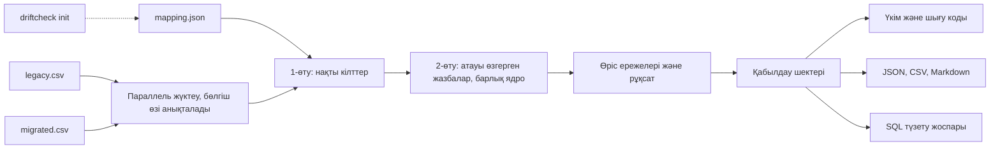

<div align="center">

# driftcheck

**Деректерді көшіруді жазбама-жазба тексеріп, оны қабылдауға бола ма, соны айтады. Өзі сәйкестенетін Python құралынан 159 есе жылдам, жауаптары бірдей.**

[English](README.md) · [Русский](README.ru.md) · [Қазақша](README.kk.md)


</div>

## Не істейді

Сіз клиенттерді, тапсырыстарды немесе жеткізушілерді бір жүйеден екіншісіне көшірдіңіз. Екі жақта да 120 000 жол. driftcheck бұлар мәндері бірдей сол 120 000 жазба ма, соны айтады және өзгеше әрбір жазбаны тізіп шығады.

```text
$ driftcheck check --source legacy.csv --target migrated.csv --contract mapping.json --csv findings.csv
driftcheck  legacy.csv -> migrated.csv
120300 source rows, 118700 target rows, loaded in 185 ms, reconciled in 2007 ms

  matched            107000
  fuzzy_matched        4000
  changed              6500
  source_only          2800
  target_only          1200
  ambiguous               0

  changed fields       6500
    plan -> tier                          3000    2.55%
    mrr -> monthly_revenue                2000     1.7%
    start_date -> activated_at            1500    1.28%
  repeated source keys: 300

quality 91.4  rejected
  - 6500 changed records exceeds allowed maximum 0
  - 2800 source-only records exceeds allowed maximum 0
  - 1200 target-only records exceeds allowed maximum 0
  - quality score 91.4 is below required 99.0
```

| Нәтиже | Мағынасы |
|---|---|
| `matched` | Кілт сәйкес, маппингтің барлық өрісі келіседі |
| `fuzzy_matched` | Кілт өзгерген, жазба атауы мен email бойынша табылды |
| `changed` | Жазба табылды, бірақ өріс ереже шегінен тыс өзгеше, екі мән де есепте |
| `source_only` | Ескі жүйеде бар, жаңасында жоқ |
| `target_only` | Жаңа жүйеде бар, ескісінен оған ештеңе меңземейді |
| `ambiguous` | Екі үміткер шамамен бірдей балл жинады, шешімді адам қабылдайды |

Пішімдеу айырмашылық болып саналмайды. Бас әріпті email, атаудың шетіндегі бос орындар, `1.290,00` пен `1290`, `02.03.2026` пен `2026-03-02` сәйкес келеді.

## Осы нұсқадағы жаңалықтар (0.2)

0.1 нұсқасы бір сұраққа жауап берді: көшіруді қабылдауға бола ма. 0.2 нұсқасы тексеруге дейінгі және одан кейінгі кезеңді де қамтиды. Келісімшартты қолмен жазудың қажеті жоқ, есеп мәселенің қай бағанда екенін көрсетеді, ал нәтижесінде мақсатты түзететін SQL шығады.

| Не | Қазір қалай жұмыс істейді |
|---|---|
| `driftcheck init` | Маппинг келісімшартын екі файл бойынша құрастырады. Бағандар мазмұны бойынша жұптасады, сондықтан атаулары әртүрлі болса да `full_name` `name`-ді, ал `mrr` `monthly_revenue`-ды табады. Кілт, әр жұптың ережесі және атауы өзгерген жазбаларды іздейтін өрістер де осылай таңдалады. 120 000 жолда жоба 1,7 с-та дайын болады және қолмен жазылған келісімшартпен бірдей үкім береді |
| Өрістер бойынша бөлу | Қорытынды мен JSON есебі айырмашылығы бар әр бағанды ең нашарынан бастап саны мен үлесімен тізеді: `plan -> tier  3000  2.55%`. Мәселе 6 500 әртүрлі қатеде емес, тариф маппингінде екені бірден көрінеді |
| SQL түзету жоспары | `--patch fix.sql --table crm.customers` бір транзакция жазады: өзгерген әр жазба үшін тек айырмашылығы бар өрістердің `UPDATE`-і, жоғалған әр жазба үшін `INSERT` және артық әр жазба үшін түсініктемеге алынған `DELETE`, жоюды адам шешеді. Дереккөзде қайталанған кілттер белгімен өткізіліп жіберіледі. Мәндер мен атаулардағы тырнақшалар экрандалады |
| Markdown есебі | `--markdown "$GITHUB_STEP_SUMMARY"` үкімді, санауыштарды, өрістер кестесін және алғашқы 25 табылғанды GitHub Actions тапсырмасының бетіне шығарады. Файл толықтырылады, сондықтан бірнеше тексеру бір қорытындыны бөліседі |
| Кез келген бөлгіш | `;`, табуляция немесе `\|` бар файлдар параметрсіз жүктеледі. Бөлгіш тақырып жолынан анықталады, ал `--delimiter` оны нақты береді |

Салыстыру жылдамдығы 0.1-дегідей: сол ноутбукта 120 000 жол шамамен 2,5 с.

```bash
driftcheck init  --source legacy.csv --target migrated.csv              # mapping.json жазады
driftcheck check --source legacy.csv --target migrated.csv --contract mapping.json \
  --patch fix.sql --table crm.customers --markdown summary.md
```

```text
driftcheck init  legacy.csv -> migrated.csv

  key  customer_id -> id
       full_name              -> name                   text               values 100.0%
       email                  -> email_address          email              values  99.0%
       plan                   -> tier                   text               values 100.0%
       mrr                    -> monthly_revenue        numeric_tolerance  values 100.0%
       start_date             -> activated_at           date               values 100.0%
       country                -> country_code           text               values 100.0%
  renamed records are searched by: full_name, email
```

```sql
BEGIN;
UPDATE "crm"."customers" SET "tier" = 'Business' WHERE "id" = 'C-100005';
UPDATE "crm"."customers" SET "monthly_revenue" = '299.00' WHERE "id" = 'C-100090';
INSERT INTO "crm"."customers" ("id", "name", "email_address", "tier", "monthly_revenue", "activated_at", "country_code")
  VALUES ('C-100127', 'Mason Tanaka', '9x6oyh3cvdo3@example.com', 'Business', '299.00', '2025-04-19', 'ES');
-- DELETE FROM "crm"."customers" WHERE "id" = 'C-901149';
COMMIT;
-- 6500 updates, 2500 inserts, 1200 deletes to review, 300 skipped
```

## Жылдамдық

Бірдей генерацияланған көшірулер, бірдей маппинг келісімшарты, бір ноутбук (Intel i7-3612QM, 4 ядро, 8 ағын, 2012 жыл). Уақыт файлдарды оқуды қоса есептелген.

| Жолдар | SyncProof (Python) | driftcheck, 8 ағын | driftcheck, 1 ағын |
|---:|---:|---:|---:|
| 12 000 | 5,28 с | 0,23 с | 0,28 с |
| 120 000 | 393,8 с | 2,47 с | 5,92 с |

Екі өлшемде де құралдар бірдей сандар берді. 120 000 жолда бұл 107 000 сәйкес, 4 000 атауы өзгерген, 6 500 өзгерген, 2 800 жоғалған және 1 200 артық жазба.

Уақыттың көбі кілті өзгерген жазбаларға кетеді: әрқайсысы мақсаттың барлық бос жолымен салыстырылады. driftcheck мұны бір машиналық сөзде 64 таңбаны өңдейтін бит-параллель алгоритммен жасайды және үміткерлерді барлық ядроларға бөледі.

Өлшеуді қайталау:

```bash
cargo build --release
./target/release/driftcheck gen --rows 120000 --out bench/data/120000
./target/release/driftcheck check --source bench/data/120000/legacy.csv --target bench/data/120000/migrated.csv --contract bench/data/120000/mapping.json
python bench/syncproof_bench.py ../syncproof bench/data/120000   # venv-і бар SyncProof көшірмесі қажет
```

## Тексеру қалай өтеді



Алдымен нақты кілттер алынады, сондықтан бұлыңғыр болжам басқа кілттің жолын тартып ала алмайды, ал нәтиже жолдар ретіне тәуелді емес.

## Жылдам бастау

```bash
cargo install --path .
driftcheck gen --rows 1200 --out demo           # ақаулары белгілі көшіру
driftcheck init --source demo/legacy.csv --target demo/migrated.csv --out demo/drafted.json
driftcheck check --source demo/legacy.csv --target demo/migrated.csv \
  --contract demo/drafted.json --json report.json --csv findings.csv --patch fix.sql
echo $?                                         # 0 қабылданды, 1 қабылданбады, 2 қате
```

| `check` параметрі | Мақсаты |
|---|---|
| `--json report.json` | Өрістер бойынша бөлуі бар JSON қорытынды. `--records` қосылса, әр жазба кіреді |
| `--csv findings.csv` | Әр айырмашылық пен жұбы жоқ әр жазбаға бір жол, Excel-де ашу қауіпсіз |
| `--all` | CSV-ге кілт бойынша таза сәйкестіктерді де қосу |
| `--markdown summary.md` | Markdown қорытындысын қосу, мысалы `$GITHUB_STEP_SUMMARY`-ге |
| `--patch fix.sql` | SQL түзету жоспарын жазу. `--table schema.table` мақсат кестесін береді |
| `--delimiter semicolon` | Бөлгішті автоанықтаудың орнына беру: таңба немесе `comma`, `semicolon`, `tab`, `pipe` |
| `--threads N` | Ағындар санын шектеу |
| `--quiet` | Ештеңе шығармау, шығу коды мен есептерге сүйену |

`init` әдепкіде `mapping.json` жазады, `--force`-сыз бар файлды қайта жазбайды және әр жұпты ортақ мәндердің үлесімен шығарады. Жұбы жоқ бағандар тізіледі, сондықтан ештеңе үнсіз жоғалмайды.

## Маппинг келісімшарты

[SyncProof](https://github.com/artyom129/syncproof) оқитын JSON-ның өзі, сондықтан бір келісімшарт екі құралда да жұмыс істейді.

```json
{
  "source_key": "customer_id",
  "target_key": "id",
  "mappings": [
    {"source": "full_name",  "target": "name",            "rule": "text"},
    {"source": "email",      "target": "email_address",   "rule": "email"},
    {"source": "mrr",        "target": "monthly_revenue", "rule": "numeric_tolerance", "tolerance": 0.01},
    {"source": "start_date", "target": "activated_at",    "rule": "date"}
  ],
  "fuzzy_fields": [
    {"source": "full_name", "target": "name"},
    {"source": "email",     "target": "email_address"}
  ],
  "fuzzy_threshold": 90,
  "acceptance": {"max_changed": 0, "max_source_only": 0, "max_target_only": 0, "min_quality_score": 99}
}
```

| Ереже | Нені салыстырады |
|---|---|
| `exact` | Мәндерді сол күйінде |
| `text` | Шеттегі бос орындарсыз, регистрсіз және қайталанған бос орынсыз мәтін |
| `email` | Мекенжайларды регистрді ескермей |
| `numeric` | Сандар: `1,234.50`, `1.234,50` және `$1,234.5` сәйкес келеді |
| `numeric_tolerance` | `tolerance` шегіндегі сандар |
| `date` | ISO, `YYYY/MM/DD`, `MM/DD/YYYY` және `DD.MM.YYYY`, `tolerance` күнмен |

## Конвейерде

Шығу коды тексеруді тосқауылға айналдырады: ақау қалдырған көшіру тапсырмасы құрастыруды құлатады.

```yaml
- name: Migration acceptance
  run: >
    driftcheck check --source export/legacy.csv --target export/new.csv --contract mapping.json
    --csv findings.csv --patch fix.sql --markdown "$GITHUB_STEP_SUMMARY"
```

Үкім мен өрістер кестесі тапсырма бетінде пайда болады, ал түзету жоспарын тексеру үшін құрастыру артефактісі ретінде сақтауға болады.

## Тесттер

```bash
cargo test --release
```

40 тест. Негізгісі SyncProof-тың 1 200 клиенттік өз тест жинағын іске қосады және бірдей сандарды, 91.4 сапа бағасын және бас тартудың төрт себебін сөзбе-сөз талап етеді. Екіншісі 20 000 жол генерациялап, салынған әр ақаудың табылуын талап етеді. `init` тесттері келісімшарт жобасының 1 200 және 30 000 араластырылған жолда барлық жеті бағанды жұптауын және онымен тексеру салынған әр ақауды табуын талап етеді. SQL жоспарының тесттері экрандауды және жол ауыстыруы бар мәндерді тексереді. CI Linux пен Windows-та жұмыс істейді, келісімшарт құрастырады, сол бойынша тексереді және қорытындыны тапсырма бетіне жазады.

## Жоба құрылымы

```text
src/
  config.rs     маппинг келісімшарты
  data.rs       CSV жүктеу және бөлгішті анықтау
  value.rs      салыстыру ережелері: мәтін, сандар, күндер
  fuzzy.rs      атауы өзгерген жазбалар үшін бит-параллель ұқсастық
  reconcile.rs  екі өту, нәтижелер, өрістер бойынша бөлу және үкім
  infer.rs      driftcheck init: деректер бойынша келісімшарт
  patch.rs      SQL түзету жоспары
  report.rs     терминалдағы қорытынды, JSON, CSV және Markdown
  gen.rs        ақаулары белгілі кез келген өлшемдегі тест көшірулері
  main.rs       командалық жол
tests/compat.rs SyncProof тест жинағы және 20 000 жолдық іске қосу
bench/          SyncProof өлшеу скрипті
```

## Нұсқалар

| Нұсқа | Не әкелді |
|---|---|
| **0.2.0** | `driftcheck init` келісімшартты деректер бойынша құрастырады. Терминал мен JSON-да өрістер бойынша бөлу. `--patch` арқылы SQL түзету жоспары. `--markdown` арқылы Markdown қорытындысы. Бөлгішті анықтау және `--delimiter`. 40 тест |
| 0.1.0 | SyncProof келісімшарттарымен үйлесімді жазбама-жазба салыстыру: екі өту, алты нәтиже, қабылдау шектері, JSON және CSV есептері, шығу кодтары, тест деректерінің генераторы. 120 000 жолда SyncProof-тан 159 есе жылдам. 26 тест |

---

<div align="center">

Авторы: **[Koncha Artyom](https://github.com/artyom129)** · MIT лицензиясы

</div>
