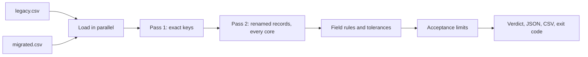

<div align="center">

# driftcheck

**Checks a data migration record by record and says whether it can be accepted. 159 times faster than the Python tool it was built to match, with the same answers.**

[English](README.md) · [Русский](README.ru.md) · [Қазақша](README.kk.md)


</div>

## What it does

You moved customers, orders or vendors from one system to another. Both sides have 120,000 rows. driftcheck tells you whether they are the same 120,000 records with the same values, and lists every one that is not.

```text
$ driftcheck check --source legacy.csv --target migrated.csv --contract mapping.json --csv findings.csv
driftcheck  legacy.csv -> migrated.csv
120300 source rows, 118700 target rows, loaded in 185 ms, reconciled in 2007 ms

  matched            107000
  fuzzy_matched        4000
  changed              6500
  source_only          2800
  target_only          1200
  ambiguous               0

  changed fields       6500
  repeated source keys: 300

quality 91.4  rejected
  - 6500 changed records exceeds allowed maximum 0
  - 2800 source-only records exceeds allowed maximum 0
  - 1200 target-only records exceeds allowed maximum 0
  - quality score 91.4 is below required 99.0
```

| Outcome | Meaning |
|---|---|
| `matched` | Same key, every mapped field agrees |
| `fuzzy_matched` | The key changed, the record was found by name and email |
| `changed` | Found, but a field differs beyond its rule, with both values in the report |
| `source_only` | In the old system, missing in the new one |
| `target_only` | In the new system, nothing in the old one points to it |
| `ambiguous` | Two candidates scored too close to call, left for a person |

Formatting is not a difference. Upper-case emails, padded names, `1.290,00` against `1290`, and `02.03.2026` against `2026-03-02` all agree.

## Speed

The same generated migrations, the same mapping contract, the same laptop (Intel i7-3612QM, 4 cores, 8 threads, from 2012). Times include reading the files.

| Rows | SyncProof (Python) | driftcheck, 8 threads | driftcheck, 1 thread |
|---:|---:|---:|---:|
| 12,000 | 5.28 s | 0.23 s | 0.28 s |
| 120,000 | 393.8 s | 2.47 s | 5.92 s |

Both tools returned identical counts on both sizes: 107,000 matched, 4,000 renamed, 6,500 changed, 2,800 missing, 1,200 extra at 120,000 rows.

Most of the time goes to the records whose key changed: each one is compared with every unclaimed target row. driftcheck does that comparison with a bit-parallel algorithm that handles 64 characters per machine word, and spreads the candidates over all cores.

Repeat it yourself:

```bash
cargo build --release
./target/release/driftcheck gen --rows 120000 --out bench/data/120000
./target/release/driftcheck check --source bench/data/120000/legacy.csv --target bench/data/120000/migrated.csv --contract bench/data/120000/mapping.json
python bench/syncproof_bench.py ../syncproof bench/data/120000   # needs a SyncProof checkout with its venv
```

## How a check runs



Exact keys are claimed first, so a fuzzy guess can never take a row that belongs to another key, and the result does not depend on row order.

## Quick start

```bash
cargo install --path .
driftcheck gen --rows 1200 --out demo           # a migration with known damage
driftcheck check --source demo/legacy.csv --target demo/migrated.csv \
  --contract demo/mapping.json --json report.json --csv findings.csv
echo $?                                         # 0 accepted, 1 rejected, 2 error
```

| Option | Purpose |
|---|---|
| `--json report.json` | Summary as JSON. Add `--records` for every record |
| `--csv findings.csv` | One row per difference and per unmatched record, safe to open in Excel |
| `--all` | Also list clean key matches in the CSV |
| `--threads N` | Limit the worker threads |
| `--quiet` | Print nothing, rely on the exit code and the reports |

## The mapping contract

The same JSON that [SyncProof](https://github.com/artyom129/syncproof) reads, so one contract works in either tool.

```json
{
  "source_key": "customer_id",
  "target_key": "id",
  "mappings": [
    {"source": "full_name",  "target": "name",            "rule": "text"},
    {"source": "email",      "target": "email_address",   "rule": "email"},
    {"source": "mrr",        "target": "monthly_revenue", "rule": "numeric_tolerance", "tolerance": 0.01},
    {"source": "start_date", "target": "activated_at",    "rule": "date"}
  ],
  "fuzzy_fields": [
    {"source": "full_name", "target": "name"},
    {"source": "email",     "target": "email_address"}
  ],
  "fuzzy_threshold": 90,
  "acceptance": {"max_changed": 0, "max_source_only": 0, "max_target_only": 0, "min_quality_score": 99}
}
```

| Rule | Compares |
|---|---|
| `exact` | Values as they are |
| `text` | Text without padding, case or repeated spaces |
| `email` | Addresses, case-insensitive |
| `numeric` | Numbers, so `1,234.50`, `1.234,50` and `$1,234.5` agree |
| `numeric_tolerance` | Numbers within `tolerance` |
| `date` | ISO, `YYYY/MM/DD`, `MM/DD/YYYY` and `DD.MM.YYYY`, `tolerance` in days |

## In a pipeline

The exit code makes it a gate: a migration job that leaves damage behind fails the build.

```yaml
- name: Migration acceptance
  run: driftcheck check --source export/legacy.csv --target export/new.csv --contract mapping.json --csv findings.csv
```

## Tests

```bash
cargo test --release
```

26 tests. The main one runs SyncProof's own 1,200-customer test set and requires the same counts, the same quality score of 91.4 and the same four rejection reasons, word for word. Another generates 20,000 rows and requires every planted defect to be found. CI runs on Linux and Windows.

## Project layout

```text
src/
  config.rs     the mapping contract
  data.rs       CSV loading
  value.rs      comparison rules: text, numbers, dates
  fuzzy.rs      bit-parallel similarity for renamed records
  reconcile.rs  the two passes, outcomes and the verdict
  report.rs     terminal summary, JSON and CSV
  gen.rs        test migrations of any size with known defects
  main.rs       command line
tests/compat.rs SyncProof's test set and a 20,000-row run
bench/          the SyncProof timing script
```

---

<div align="center">

Built by **[Koncha Artyom](https://github.com/artyom129)** · MIT License

</div>
