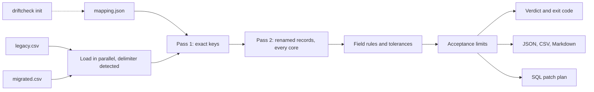

<div align="center">

# driftcheck

**Checks a data migration record by record and says whether it can be accepted. 159 times faster than the Python tool it was built to match, with the same answers.**

[English](README.md) · [Русский](README.ru.md) · [Қазақша](README.kk.md)


</div>

## What it does

You moved customers, orders or vendors from one system to another. Both sides have 120,000 rows. driftcheck tells you whether they are the same 120,000 records with the same values, and lists every one that is not.

```text
$ driftcheck check --source legacy.csv --target migrated.csv --contract mapping.json --csv findings.csv
driftcheck  legacy.csv -> migrated.csv
120300 source rows, 118700 target rows, loaded in 185 ms, reconciled in 2007 ms

  matched            107000
  fuzzy_matched        4000
  changed              6500
  source_only          2800
  target_only          1200
  ambiguous               0

  changed fields       6500
    plan -> tier                          3000    2.55%
    mrr -> monthly_revenue                2000     1.7%
    start_date -> activated_at            1500    1.28%
  repeated source keys: 300

quality 91.4  rejected
  - 6500 changed records exceeds allowed maximum 0
  - 2800 source-only records exceeds allowed maximum 0
  - 1200 target-only records exceeds allowed maximum 0
  - quality score 91.4 is below required 99.0
```

| Outcome | Meaning |
|---|---|
| `matched` | Same key, every mapped field agrees |
| `fuzzy_matched` | The key changed, the record was found by name and email |
| `changed` | Found, but a field differs beyond its rule, with both values in the report |
| `source_only` | In the old system, missing in the new one |
| `target_only` | In the new system, nothing in the old one points to it |
| `ambiguous` | Two candidates scored too close to call, left for a person |

Formatting is not a difference. Upper-case emails, padded names, `1.290,00` against `1290`, and `02.03.2026` against `2026-03-02` all agree.

## What's new in 0.2

Version 0.1 answered one question: can this migration be accepted? Version 0.2 also covers what happens before and after the check. You no longer have to write the contract by hand, the report shows which column has the problem, and you get the SQL that fixes the target.

| What | How it works now |
|---|---|
| `driftcheck init` | Drafts the mapping contract from the two files. Columns are paired by their content, so `full_name` finds `name` and `mrr` finds `monthly_revenue` even though the names differ. The key, the rule for each pair and the fields used to find renamed records are chosen the same way. On 120,000 rows the draft takes 1.7 s and gives the same verdict as a contract written by hand |
| Per-field breakdown | The summary and the JSON report list every column that differs, worst first, with a count and a share: `plan -> tier  3000  2.55%`. You see straight away that the plan mapping is the problem, not 6,500 unrelated errors |
| SQL patch plan | `--patch fix.sql --table crm.customers` writes one transaction: an `UPDATE` of only the differing fields for every changed record, an `INSERT` for every missing one, and a commented-out `DELETE` for every extra one, so a person decides what gets removed. Keys repeated in the source are skipped and reported. Quotes in values and identifiers are escaped |
| Markdown report | `--markdown "$GITHUB_STEP_SUMMARY"` adds the verdict, the counts, the per-field table and the first 25 findings to the GitHub Actions job page. The file is appended to, so several checks can share one summary |
| Any delimiter | Files exported with `;`, tabs or `\|` load without options. The delimiter is read from the header line, and `--delimiter` sets it explicitly |

Reconciliation speed is the same as in 0.1: 120,000 rows in about 2.5 s on the same laptop.

```bash
driftcheck init  --source legacy.csv --target migrated.csv              # writes mapping.json
driftcheck check --source legacy.csv --target migrated.csv --contract mapping.json \
  --patch fix.sql --table crm.customers --markdown summary.md
```

```text
driftcheck init  legacy.csv -> migrated.csv

  key  customer_id -> id
       full_name              -> name                   text               values 100.0%
       email                  -> email_address          email              values  99.0%
       plan                   -> tier                   text               values 100.0%
       mrr                    -> monthly_revenue        numeric_tolerance  values 100.0%
       start_date             -> activated_at           date               values 100.0%
       country                -> country_code           text               values 100.0%
  renamed records are searched by: full_name, email
```

```sql
BEGIN;
UPDATE "crm"."customers" SET "tier" = 'Business' WHERE "id" = 'C-100005';
UPDATE "crm"."customers" SET "monthly_revenue" = '299.00' WHERE "id" = 'C-100090';
INSERT INTO "crm"."customers" ("id", "name", "email_address", "tier", "monthly_revenue", "activated_at", "country_code")
  VALUES ('C-100127', 'Mason Tanaka', '9x6oyh3cvdo3@example.com', 'Business', '299.00', '2025-04-19', 'ES');
-- DELETE FROM "crm"."customers" WHERE "id" = 'C-901149';
COMMIT;
-- 6500 updates, 2500 inserts, 1200 deletes to review, 300 skipped
```

## Speed

The same generated migrations, the same mapping contract, the same laptop (Intel i7-3612QM, 4 cores, 8 threads, from 2012). Times include reading the files.

| Rows | SyncProof (Python) | driftcheck, 8 threads | driftcheck, 1 thread |
|---:|---:|---:|---:|
| 12,000 | 5.28 s | 0.23 s | 0.28 s |
| 120,000 | 393.8 s | 2.47 s | 5.92 s |

Both tools returned identical counts on both sizes: 107,000 matched, 4,000 renamed, 6,500 changed, 2,800 missing, 1,200 extra at 120,000 rows.

Most of the time goes to the records whose key changed: each one is compared with every unclaimed target row. driftcheck does that comparison with a bit-parallel algorithm that handles 64 characters per machine word, and spreads the candidates over all cores.

Repeat it yourself:

```bash
cargo build --release
./target/release/driftcheck gen --rows 120000 --out bench/data/120000
./target/release/driftcheck check --source bench/data/120000/legacy.csv --target bench/data/120000/migrated.csv --contract bench/data/120000/mapping.json
python bench/syncproof_bench.py ../syncproof bench/data/120000   # needs a SyncProof checkout with its venv
```

## How a check runs



Exact keys are claimed first, so a fuzzy guess can never take a row that belongs to another key, and the result does not depend on row order.

## Quick start

```bash
cargo install --path .
driftcheck gen --rows 1200 --out demo           # a migration with known damage
driftcheck init --source demo/legacy.csv --target demo/migrated.csv --out demo/drafted.json
driftcheck check --source demo/legacy.csv --target demo/migrated.csv \
  --contract demo/drafted.json --json report.json --csv findings.csv --patch fix.sql
echo $?                                         # 0 accepted, 1 rejected, 2 error
```

| Option of `check` | Purpose |
|---|---|
| `--json report.json` | Summary as JSON, with the per-field breakdown. Add `--records` for every record |
| `--csv findings.csv` | One row per difference and per unmatched record, safe to open in Excel |
| `--all` | Also list clean key matches in the CSV |
| `--markdown summary.md` | Append a Markdown summary, for example to `$GITHUB_STEP_SUMMARY` |
| `--patch fix.sql` | Write the SQL patch plan. `--table schema.table` names the target table |
| `--delimiter semicolon` | Set the delimiter instead of detecting it: a character or `comma`, `semicolon`, `tab`, `pipe` |
| `--threads N` | Limit the worker threads |
| `--quiet` | Print nothing, rely on the exit code and the reports |

`init` writes `mapping.json` by default, will not overwrite an existing file without `--force`, and prints every pair with the share of values the two columns have in common. Columns it could not pair are listed, so nothing is dropped silently.

## The mapping contract

The same JSON that [SyncProof](https://github.com/artyom129/syncproof) reads, so one contract works in either tool.

```json
{
  "source_key": "customer_id",
  "target_key": "id",
  "mappings": [
    {"source": "full_name",  "target": "name",            "rule": "text"},
    {"source": "email",      "target": "email_address",   "rule": "email"},
    {"source": "mrr",        "target": "monthly_revenue", "rule": "numeric_tolerance", "tolerance": 0.01},
    {"source": "start_date", "target": "activated_at",    "rule": "date"}
  ],
  "fuzzy_fields": [
    {"source": "full_name", "target": "name"},
    {"source": "email",     "target": "email_address"}
  ],
  "fuzzy_threshold": 90,
  "acceptance": {"max_changed": 0, "max_source_only": 0, "max_target_only": 0, "min_quality_score": 99}
}
```

| Rule | Compares |
|---|---|
| `exact` | Values as they are |
| `text` | Text without padding, case or repeated spaces |
| `email` | Addresses, case-insensitive |
| `numeric` | Numbers, so `1,234.50`, `1.234,50` and `$1,234.5` agree |
| `numeric_tolerance` | Numbers within `tolerance` |
| `date` | ISO, `YYYY/MM/DD`, `MM/DD/YYYY` and `DD.MM.YYYY`, `tolerance` in days |

## In a pipeline

The exit code makes it a gate: a migration job that leaves damage behind fails the build.

```yaml
- name: Migration acceptance
  run: >
    driftcheck check --source export/legacy.csv --target export/new.csv --contract mapping.json
    --csv findings.csv --patch fix.sql --markdown "$GITHUB_STEP_SUMMARY"
```

The verdict and the per-field table then appear on the job page, and the patch plan can be kept as a build artifact for review.

## Tests

```bash
cargo test --release
```

40 tests. The main one runs SyncProof's own 1,200-customer test set and requires the same counts, the same quality score of 91.4 and the same four rejection reasons, word for word. Another generates 20,000 rows and requires every planted defect to be found. The `init` tests require the drafted contract to pair all seven columns on 1,200 and 30,000 shuffled rows and to find every planted defect when used for a check. The patch plan tests cover quoting and values with line breaks. CI runs on Linux and Windows, drafts a contract, checks with it and writes the summary to the job page.

## Project layout

```text
src/
  config.rs     the mapping contract
  data.rs       CSV loading and delimiter detection
  value.rs      comparison rules: text, numbers, dates
  fuzzy.rs      bit-parallel similarity for renamed records
  reconcile.rs  the two passes, outcomes, per-field breakdown and the verdict
  infer.rs      driftcheck init: a contract drafted from the data
  patch.rs      SQL patch plan
  report.rs     terminal summary, JSON, CSV and Markdown
  gen.rs        test migrations of any size with known defects
  main.rs       command line
tests/compat.rs SyncProof's test set and a 20,000-row run
bench/          the SyncProof timing script
```

## Versions

| Version | What it brought |
|---|---|
| **0.2.0** | `driftcheck init` drafts the contract from the data. Per-field breakdown in the terminal and JSON. SQL patch plan with `--patch`. Markdown summary with `--markdown`. Delimiter detection and `--delimiter`. 40 tests |
| 0.1.0 | Record-by-record reconciliation compatible with SyncProof contracts: two passes, six outcomes, acceptance limits, JSON and CSV reports, exit codes, the test-data generator. 159 times faster than SyncProof on 120,000 rows. 26 tests |

---

<div align="center">

Built by **[Koncha Artyom](https://github.com/artyom129)** · MIT License

</div>
