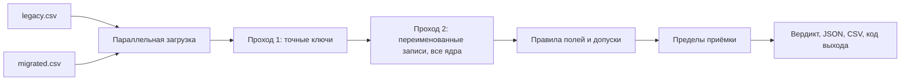

<div align="center">

# driftcheck

**Проверяет миграцию данных запись за записью и говорит, можно ли её принять. В 159 раз быстрее Python-инструмента, с которым сверяется, и с теми же ответами.**

[English](README.md) · [Русский](README.ru.md) · [Қазақша](README.kk.md)


</div>

## Что делает

Вы перенесли клиентов, заказы или поставщиков из одной системы в другую. С обеих сторон по 120 000 строк. driftcheck скажет, те же ли это 120 000 записей с теми же значениями, и перечислит каждую, которая отличается.

```text
$ driftcheck check --source legacy.csv --target migrated.csv --contract mapping.json --csv findings.csv
driftcheck  legacy.csv -> migrated.csv
120300 source rows, 118700 target rows, loaded in 185 ms, reconciled in 2007 ms

  matched            107000
  fuzzy_matched        4000
  changed              6500
  source_only          2800
  target_only          1200
  ambiguous               0

  changed fields       6500
  repeated source keys: 300

quality 91.4  rejected
  - 6500 changed records exceeds allowed maximum 0
  - 2800 source-only records exceeds allowed maximum 0
  - 1200 target-only records exceeds allowed maximum 0
  - quality score 91.4 is below required 99.0
```

| Исход | Что значит |
|---|---|
| `matched` | Ключ совпал, все поля маппинга согласны |
| `fuzzy_matched` | Ключ сменился, запись найдена по имени и email |
| `changed` | Запись найдена, но поле расходится сверх правила, оба значения в отчёте |
| `source_only` | Есть в старой системе, нет в новой |
| `target_only` | Есть в новой системе, из старой на неё ничего не указывает |
| `ambiguous` | Два кандидата набрали почти одинаково, решать человеку |

Форматирование различием не считается. Email в верхнем регистре, пробелы вокруг имени, `1.290,00` против `1290` и `02.03.2026` против `2026-03-02` совпадают.

## Скорость

Одни и те же сгенерированные миграции, один контракт маппинга, один ноутбук (Intel i7-3612QM, 4 ядра, 8 потоков, 2012 год). Время вместе с чтением файлов.

| Строк | SyncProof (Python) | driftcheck, 8 потоков | driftcheck, 1 поток |
|---:|---:|---:|---:|
| 12 000 | 5,28 с | 0,23 с | 0,28 с |
| 120 000 | 393,8 с | 2,47 с | 5,92 с |

На обоих размерах инструменты дали одинаковые числа. На 120 000 строк это 107 000 совпавших, 4 000 переименованных, 6 500 изменённых, 2 800 пропавших и 1 200 лишних.

Больше всего времени уходит на записи со сменившимся ключом: каждую сравнивают со всеми свободными строками цели. driftcheck делает это битово-параллельным алгоритмом, который обрабатывает 64 символа за одно машинное слово, и раскладывает кандидатов по всем ядрам.

Повторить замер:

```bash
cargo build --release
./target/release/driftcheck gen --rows 120000 --out bench/data/120000
./target/release/driftcheck check --source bench/data/120000/legacy.csv --target bench/data/120000/migrated.csv --contract bench/data/120000/mapping.json
python bench/syncproof_bench.py ../syncproof bench/data/120000   # нужен клон SyncProof с его venv
```

## Как проходит проверка



Сначала занимаются точные ключи, поэтому нечёткая догадка не может отнять строку у другого ключа, а результат не зависит от порядка строк.

## Быстрый старт

```bash
cargo install --path .
driftcheck gen --rows 1200 --out demo           # миграция с известными повреждениями
driftcheck check --source demo/legacy.csv --target demo/migrated.csv \
  --contract demo/mapping.json --json report.json --csv findings.csv
echo $?                                         # 0 принято, 1 отклонено, 2 ошибка
```

| Параметр | Назначение |
|---|---|
| `--json report.json` | Сводка в JSON. С `--records` туда попадает каждая запись |
| `--csv findings.csv` | Строка на каждое различие и каждую запись без пары, файл безопасно открывать в Excel |
| `--all` | Включить в CSV и чистые совпадения по ключу |
| `--threads N` | Ограничить число потоков |
| `--quiet` | Ничего не печатать, смотреть на код выхода и отчёты |

## Контракт маппинга

Тот же JSON, что читает [SyncProof](https://github.com/artyom129/syncproof), поэтому один контракт работает в обоих инструментах.

```json
{
  "source_key": "customer_id",
  "target_key": "id",
  "mappings": [
    {"source": "full_name",  "target": "name",            "rule": "text"},
    {"source": "email",      "target": "email_address",   "rule": "email"},
    {"source": "mrr",        "target": "monthly_revenue", "rule": "numeric_tolerance", "tolerance": 0.01},
    {"source": "start_date", "target": "activated_at",    "rule": "date"}
  ],
  "fuzzy_fields": [
    {"source": "full_name", "target": "name"},
    {"source": "email",     "target": "email_address"}
  ],
  "fuzzy_threshold": 90,
  "acceptance": {"max_changed": 0, "max_source_only": 0, "max_target_only": 0, "min_quality_score": 99}
}
```

| Правило | Что сравнивает |
|---|---|
| `exact` | Значения как есть |
| `text` | Текст без пробелов по краям, регистра и повторных пробелов |
| `email` | Адреса без учёта регистра |
| `numeric` | Числа: `1,234.50`, `1.234,50` и `$1,234.5` совпадают |
| `numeric_tolerance` | Числа в пределах `tolerance` |
| `date` | ISO, `YYYY/MM/DD`, `MM/DD/YYYY` и `DD.MM.YYYY`, `tolerance` в днях |

## В конвейере

Код выхода превращает проверку в барьер: задача миграции, оставившая повреждения, роняет сборку.

```yaml
- name: Migration acceptance
  run: driftcheck check --source export/legacy.csv --target export/new.csv --contract mapping.json --csv findings.csv
```

## Тесты

```bash
cargo test --release
```

26 тестов. Главный прогоняет собственный тестовый набор SyncProof на 1 200 клиентов и требует тех же чисел, той же оценки качества 91.4 и тех же четырёх причин отказа слово в слово. Другой генерирует 20 000 строк и требует найти каждое заложенное повреждение. CI запускается на Linux и Windows.

## Структура проекта

```text
src/
  config.rs     контракт маппинга
  data.rs       загрузка CSV
  value.rs      правила сравнения: текст, числа, даты
  fuzzy.rs      битово-параллельная похожесть для переименованных записей
  reconcile.rs  два прохода, исходы и вердикт
  report.rs     сводка в терминале, JSON и CSV
  gen.rs        тестовые миграции любого размера с известными повреждениями
  main.rs       командная строка
tests/compat.rs тестовый набор SyncProof и прогон на 20 000 строк
bench/          скрипт замера SyncProof
```

---

<div align="center">

Автор: **[Koncha Artyom](https://github.com/artyom129)** · Лицензия MIT

</div>
